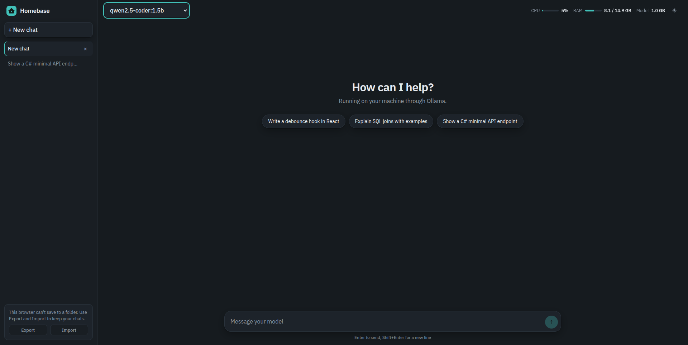

# Homebase

**Private AI chat that never leaves your machine.**

Homebase is a fast, modern chat interface for the LLMs running on my own machine through [Ollama](https://ollama.com). It is a frontend-only app: no backend, no accounts, no cloud. Your prompts and your chat history never leave your computer.



## Why I built this

I run a few Ollama models locally and kept ending up in the terminal, both to chat and to check how much CPU and RAM the model was eating. I wanted something with the polish of Claude or ChatGPT that talks straight to my local models, shows what the hardware is doing while I chat, and keeps my history on my own disk. I called it Homebase because it is the place your AI conversations live: local, familiar, and yours.

## Features

- **Streaming chat** with any model you have installed in Ollama, with a Stop button.
- **Model picker** that lists your installed models automatically; each chat remembers its own model.
- **Markdown rendering** with syntax-highlighted code blocks and a **one-click copy button** on every snippet.
- **Chat history** in a sidebar: switch between past chats, delete them, start new ones.
- **Live system stats** in the top bar: CPU, RAM, and the memory held by the currently loaded model.
- **Stall detection and retry**: if the model sends nothing for 90 seconds, the request is stopped and a Retry button appears.
- **Light and dark themes** with a manual toggle (follows your OS on first load).
- **Responsive layout**: the history sidebar collapses into a drawer on small screens.
- **History you own**: chats are saved as plain JSON files in a folder you choose, or exported and imported by hand.

## Tech stack

| Area | Choice |
| --- | --- |
| UI | React 18 + TypeScript |
| Build tool | Vite |
| State | Zustand |
| Markdown | react-markdown, remark-gfm, rehype-highlight (highlight.js) |
| Styling | Plain CSS with design tokens (no UI framework) |
| Model backend | Ollama HTTP API (`/api/chat`, `/api/tags`, `/api/ps`) |

## Getting started

### Prerequisites

- Node.js 18 or newer
- [Ollama](https://ollama.com/download) installed and running, with at least one model pulled:

```bash
ollama pull llama3.2
ollama serve   # skip if Ollama already runs as a background service
```

### Run it

```bash
git clone <your-repo-url>
cd homebase
npm install
npm run dev
```

Open the URL Vite prints (usually http://localhost:5173).

Ollama allows requests from `localhost` origins by default. If you serve the app from somewhere else, set `OLLAMA_ORIGINS` to include that origin.

## How chat history is stored

There is no database and no server. Each chat is one JSON file (`<id>.json`).

- **Chrome, Edge**: click **Choose folder** in the sidebar once. Chats are written to that folder automatically and reloaded on the next visit (the browser may ask you to re-grant access after a restart).
- **Brave**: the File System Access API is off by default. Enable it at `brave://flags/#file-system-access-api` to get the folder option.
- **Any browser, including Firefox and Safari**: use **Export** to download all chats as one JSON file and **Import** to load it back. Newer copies win when the same chat exists on both sides.

Until a folder is connected, chats live in memory only. The app warns you before you close the tab with unsaved changes.

## Design decisions

- **Frontend-only.** Ollama already exposes an HTTP API and allows localhost origins, so a backend would only add moving parts. If I add API-key providers later, a small proxy is the right place to keep keys.
- **Smooth streaming.** Tokens are buffered and flushed once per animation frame, and the in-flight reply lives in its own store rather than the persisted chat list. Finished messages are memoized, so only the message being generated re-renders.
- **Stall timeout, not total timeout.** The 90-second timer restarts on every token, so long answers that keep streaming are never cut off. Only a model that has gone silent is stopped. Change `STALL_MS` in `src/App.tsx` if you load very large models that need longer to start.
- **System stats via a dev-server plugin.** Browsers cannot read CPU or RAM, so a small Vite plugin in `vite.config.ts` serves `/api/stats` using Node's `os` module. That means the CPU and RAM meters only work with `npm run dev` or `npm run preview`; a static deployment shows just the model size from Ollama.
- **Provider boundary.** All Ollama calls live in `src/ollama.ts`, which keeps the door open for other providers later.

## Project structure

```
src/
  App.tsx         Layout, chat flow, streaming, timeout and retry
  ollama.ts       Ollama API client (list models, stream chat)
  store.ts        Chat state (Zustand) and the transient streaming state
  useFolder.ts    Folder sync, auto-save, export and import
  fs.ts           File System Access helpers
  Markdown.tsx    Markdown renderer and code block with copy button
  Stats.tsx       CPU / RAM / model memory indicator
  Logo.tsx        Brand mark (inline SVG)
  index.css       Theme tokens and styles
vite.config.ts    Vite config plus the /api/stats plugin
public/favicon.svg  App icon
```

## Known limitations

- CPU and RAM stats need the Vite dev or preview server.
- Folder saving needs a Chromium browser with the File System Access API enabled.
- No message editing or regenerate button yet.
- Local models only; no API-key providers yet.

## Roadmap

- [ ] Regenerate and edit messages
- [ ] System prompt and generation settings (temperature, context size) per chat
- [ ] Search across chat history
- [ ] Optional API-key providers behind a thin proxy
- [ ] Move in-browser state to IndexedDB for very large histories

## License

MIT. See `LICENSE`.